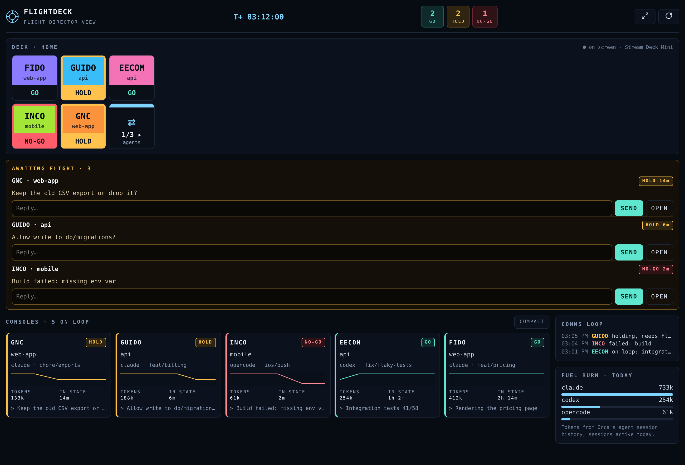
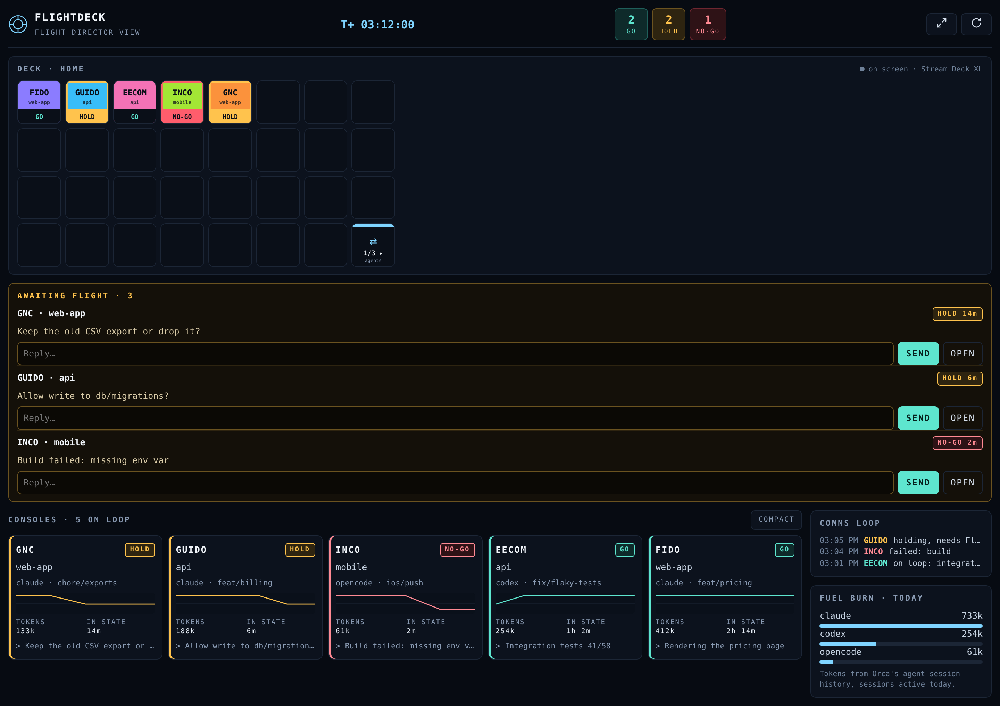

# Orca Flightdeck

**A flight deck for your coding agents in [Orca](https://orca.dev).** See every agent at a glance, answer the ones waiting on you without hunting for their terminal, and drive Orca from a deck of keys: on screen, or on any Elgato Stream Deck.

> **Public beta (v0.5.0-beta.1).** An independent plugin for Orca, not made by the Orca team. Expect rough edges and please [open an issue](https://github.com/asterysk/Orca-Flightdeck/issues) when you find one.



## What you get

| | |
|---|---|
| **Consoles** | One card per agent, across every workspace: a callsign, **GO / HOLD / NO-GO / DONE**, workspace, agent, branch, a small activity trace, tokens and time in state. Click a card to jump to its terminal. |
| **Awaiting Flight** | Every agent that is blocked, waiting or failed, at the top. Type a reply and SEND, or OPEN its terminal. |
| **Mission room** | The same view as a full-width tab in Orca's main area. Made for a second screen, or for a room. |
| **The deck** | A grid of keys on screen. It looks and works like a Stream Deck, at any size. Plug a real one in and the same keys appear on it. |
| **Comms loop, fuel burn, status bar** | Every status change, today's tokens by agent kind, and `GO 3 · HOLD 2` in Orca's status bar. |
| **Notifications** | A desktop alert when an agent goes HOLD or NO-GO. |

## Hardware optional

You don't need a Stream Deck. The deck lives in the panel and in the mission room, and its grid can match any model, or any size you like:

```
@deck mini grid = xl        # mini · neo · plus · mk2 · original · xl, or "6x4"
```



With a Stream Deck plugged in (and the optional helper running), the real deck takes over. Its own grid replaces the on-screen one, and the screen shows the same keys as a mirror. Unplug it and the on-screen grid comes back.

## The deck

The last key on every page is the page key:

- **Tap** it for the next page: 1 → 2 → 3 → 1.
- **Hold** it (half a second) to jump back to the agents.

On screen: click to tap, and hold or right-click to hold.


| Page | Keys |
|---|---|
| **1 · Agents** | Your agents, one colour each, in a fixed order. A band shows GO, HOLD or NO-GO, and HOLD and NO-GO flash. Press to jump to that agent. |
| **2 · Mission** | **RACE** starts five agents on the same prompt, each in its own new workspace · **PREVIEW** opens Orca's built-in browser · **EXPAND** opens the mission room · **URGENT** jumps to the agent that most needs you · **THEME** recolours all of Orca, dark and light in turn (hold to go back) |
| **3 · Tools** | **GRID** opens a 2×2 terminal grid · **DRIVE** uses Orca's computer use (experimental) · **ANSWER** types the reply into the agent on HOLD · **NEW** adds one more agent · **ABORT** stops what RACE and NEW started |

A slow key fills with colour and shows "working" until its action is done, so you always know a press landed.

## Install

You need **Orca 1.4.260 or later** (host API 1.10), plus Node.js 20+ for the optional deck helper.

```sh
git clone https://github.com/asterysk/Orca-Flightdeck ~/orca-flightdeck
cd ~/orca-flightdeck
orca plugin dev load .
```

Orca shows what the plugin may do and prints a fingerprint. If you agree, run the command again with `--approve <fingerprint>`. Then open **Flightdeck** from the rocket icon in Orca's right sidebar.

The `orca` command is Orca's own command line. If it's missing, turn it on in Orca's Settings (search for **Command line**, then "orca in other terminals").

### Optional: drive a real Stream Deck

Quit the Elgato Stream Deck app first, because only one program can own the deck. Then:

```sh
cd ~/orca-flightdeck/deck-helper
npm install
./install-launchagent.sh          # starts at login; ./install-launchagent.sh remove to undo
```

Log: `~/Library/Logs/flightdeck-deck.log`. Any model works: Mini, Neo, MK.2, XL, Plus (keys) and Pedal. The helper reads the deck's own grid.

### Optional: the demo deck

```sh
./scripts/install-demo-deck.sh                # RACE and NEW use the workspace you have open
./scripts/install-demo-deck.sh my-demo-repo   # or pin them to one project
```

This writes the three pages above to `~/.flightdeck/deck.vrx`, with shell keys switched on. An older file is kept as a backup.

## Make the deck yours: `~/.flightdeck/deck.vrx`

Keys are plain Verex statements (`@type id attribute = value`), one per line. The file is created the first time Flightdeck runs, and the deck updates within a second of saving.

```
@deck mini allow-shell = false
@deck mini grid = mini
@deck mini pages = [home, tools]
@page tools title = "Tools"
@key ff page = tools
@key ff slot = 1
@key ff label = "FIREFOX"
@key ff sub = "browser"
@key ff glyph = "◎"
@key ff color = "#38BDF8"
@key ff action = app
@key ff app = "Firefox"
```

| `action` | Fields | Does |
|---|---|---|
| `page` | `target` | Opens a page (`home` is the agents page) |
| `orca` | `target` | Runs an Orca built-in action, e.g. `"sidebar.right.toggle"` |
| `urgent` · `expand` · `refresh` | | Most urgent agent · mission room · poll now |
| `focus` | `workspace` | Jumps to that workspace's agent, or opens the workspace |
| `launch` | `agent`, `workspace`, `prompt` | Starts an agent in an existing workspace |
| `race` · `new` | `agents`, `count`, `prompt`, `setup`, `project` | New workspaces, each starting an agent with the prompt |
| `answer` | `text`, `enter` | Types into the agent at the top of Awaiting Flight |
| `abort` | | Stops what `race` and `new` started; with allow-shell, also removes those workspaces |
| `theme` | | Next colour scheme for all of Orca (hold: back to a dark look) |
| `app` · `url` | `app` · `url` | Opens a Mac app · an http(s) link |
| `grid` · `preview` · `drive` | `commands` · `url` · `app`, `find`, `text`, `keys` | Uses the `orca` command line: 2×2 terminal panes · built-in browser tab · computer use |
| `shortcut` · `shell` | `name` · `run` | Runs a macOS Shortcut · a shell command |

Deck settings: `allow-shell`, `grid`, `pages` (the page order) and `orca-cli` (the path to `orca`, if it isn't found). Mistakes appear in the plugin log, and the deck keeps the last good lines.

## Safety

- **Nothing types into an agent unless you press something.** SEND, ANSWER and ABORT are the only actions that send input.
- **Shell keys are off by default.** `shell`, `shortcut`, `grid`, `preview` and `drive` only run with `allow-shell = true` in `deck.vrx`, **and** only when the file can't be written by other users (`chmod 600`). Until then they show "shell off".
- **The deck helper's link is local and private.** The plugin listens on `127.0.0.1` on a random port and writes a token to `~/.flightdeck/deck.json` (mode 600). A web page can reach a loopback port but can't read that file, so it can't connect.
- **THEME changes Orca's selected theme.** Orca doesn't let a plugin switch back to a built-in theme, so holding THEME applies a close copy of Orca's dark look. To get your own theme back exactly, pick it in Orca's settings.
- **RACE creates real branches and workspaces** in your project. Try it in a scratch repository first.

## Known limits (beta)

- After the plugin restarts, ABORT forgets which agents RACE started.
- DRIVE (computer use) depends on the app's window being on your current desktop. It's experimental.
- Starting a phone simulator from a key was dropped: it used too much memory to start live.
- macOS only for the deck helper. The plugin itself follows Orca's platforms.

## Develop

```sh
orca plugin dev watch .            # load into Orca and live-reload
npm test                           # unit tests against a fake Orca host and a fake CLI
orca plugin validate .             # Orca's manifest checks
python3 scripts/preview-shot.py    # README screenshots from sample data (Playwright + Chrome)
```

Project layout: `src/worker.mjs` talks to Orca, `src/fleet.mjs` keeps the agent model, `src/deck.mjs` draws the keys, `src/deckconfig.mjs` reads `deck.vrx`, `src/bridge.mjs` is the local link to the helper, `deck-helper/` drives the hardware, and `panel/index.html` is the UI (`editor/index.html` is built from it).

## Credits

Pairing approach for the deck helper adapted from [crilofer/orca-streamdeck](https://github.com/crilofer/orca-streamdeck) (MIT). Hardware access through [`@elgato-stream-deck/node`](https://github.com/Julusian/node-elgato-stream-deck). Elgato and Stream Deck are trademarks of Corsair; this project isn't affiliated with Corsair or with Orca.

## License

MIT © 2026 Steve Charles
