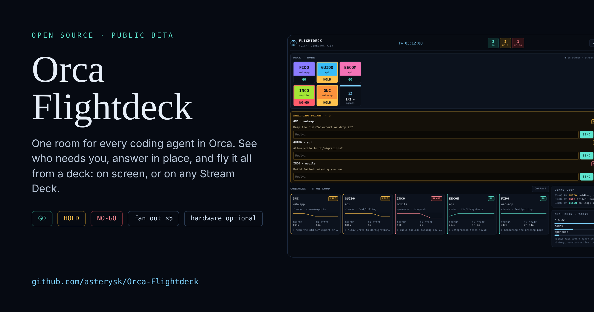
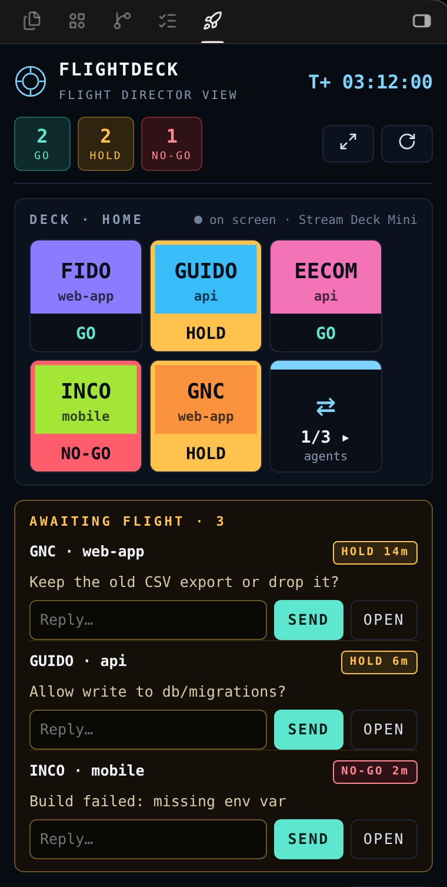
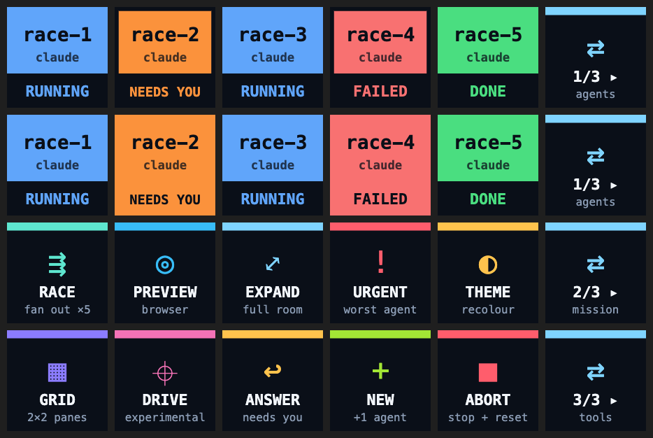
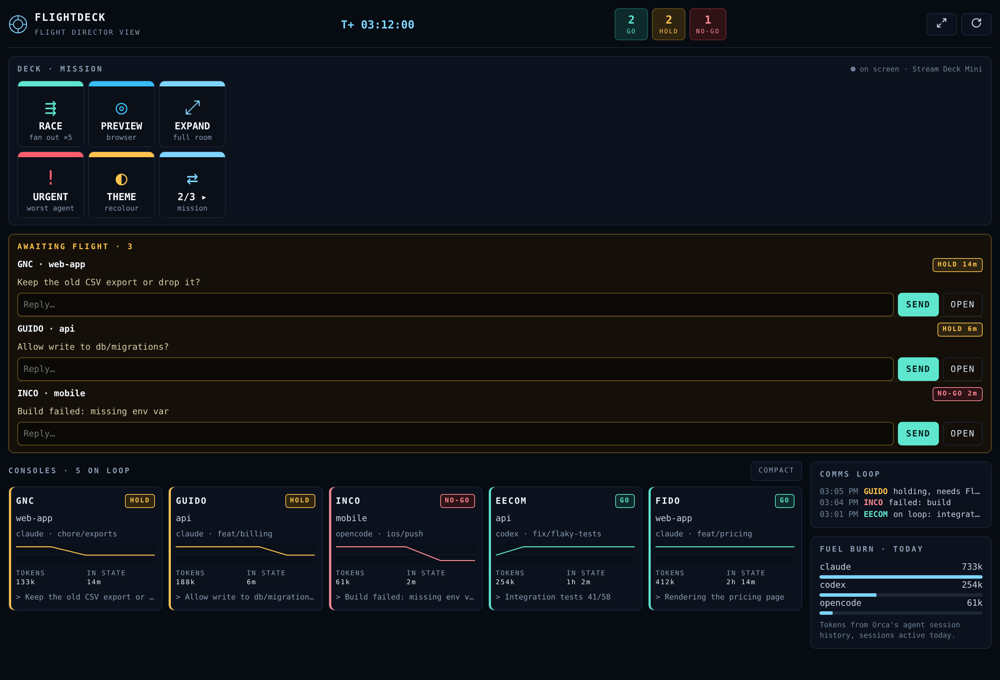

<div align="center">

# ✈︎ Flightdeck for Orca

**Run a fleet of coding agents like a mission control room.**

See every agent at a glance. Answer the ones waiting on you in one click.<br>
Fly it all from a deck of keys: on screen, or on any Stream Deck.

[](CHANGELOG.md)
[](https://orca.dev)
[](LICENSE)
[](#-hardware-optional)



[**Quick start**](#-quick-start-60-seconds) · [**Features**](#-what-it-does) · [**The deck**](#-the-deck) · [**Customise**](#-make-the-deck-yours) · [**FAQ**](#-faq)

</div>

---

## Why

[Orca](https://orca.dev) lets you run many AI coding agents at once, each on its own branch. That's powerful, and it gets noisy fast. Five agents in, you're clicking through tabs asking:

- *Which one is stuck?*
- *Which one is waiting for me to say yes?*
- *Which one just failed?*

**Flightdeck puts the answer on one screen.** Every agent shows its workspace, agent and branch, and a status in plain colours: 🔵 **Running**, 🟠 **Needs you**, 🔴 **Failed**, 🟢 **Done**. Anything waiting on you jumps to the top, with a reply box right there.

> An independent plugin for Orca, not made by the Orca team.

## 🚀 Quick start (60 seconds)

```sh
git clone https://github.com/asterysk/Orca-Flightdeck ~/orca-flightdeck
cd ~/orca-flightdeck
orca plugin dev load .
```

Orca shows what the plugin may do and gives you a fingerprint. Run the same command with `--approve <fingerprint>`, then click the **🚀 rocket** in Orca's right sidebar. That's it: no Stream Deck, no extra installs.

<sub>No `orca` command? In Orca's Settings, search **Command line** and turn on "orca in other terminals".</sub>

<p align="center">
  <br>
  <sub>The Flightdeck pane in Orca's right sidebar. The deck, activity and tokens fold away below. A short "How Flightdeck works" card shows on first run.</sub>
</p>

## ✨ What it does

<table>
<tr>
<td width="50%" valign="top">

### 🛰 Every agent, one screen
A card per agent, across all your workspaces: workspace, agent, branch, status, tokens, time in state and a live activity trace. Click a card to jump straight to its terminal. One line per agent in the sidebar, full cards in the wide view.

</td>
<td width="50%" valign="top">

### ✋ Needs you
Agents that are blocked, waiting or failed float to the top. **Type a reply and hit SEND** without leaving Flightdeck, or OPEN the terminal.

</td>
</tr>
<tr>
<td valign="top">

### 🏁 RACE
One key starts **five agents on the same task**, each in its own new workspace. Compare the results, keep the best. **ABORT** stops them all and cleans up.

</td>
<td valign="top">

### 🖥 Full-width view
Open the whole view as a **full-width tab** with the ⤢ arrows. Click them again to close it (with `allow-shell` on; otherwise they take you back to your agent). It's made for a second screen, a team room or a live demo.

</td>
</tr>
<tr>
<td valign="top">

### 🎛 A deck of keys
A Stream Deck-style grid **on screen**: agents on page one, actions on the next. Hardware is optional.

</td>
<td valign="top">

### 🔔 Never miss a question
Needs-you and failed keys **flash**, the status bar shows `Running 3 · Needs you 2`, and a desktop alert tells you when an agent needs you.

</td>
</tr>
</table>


## 🎛 The deck

Three pages, six keys each on a Stream Deck Mini. The last key turns the page:

- **Tap** it: next page (1 → 2 → 3 → 1).
- **Hold** it: straight back to your agents.



| Page | What's on it |
|---|---|
| **1 · Agents** | One key per agent: its workspace and agent, in its status colour. Press to jump to it. |
| **2 · Mission** | **RACE** five agents · **PREVIEW** in Orca's browser · **EXPAND** to the full-width view · **URGENT** jump to the agent most in need · **THEME** recolour all of Orca |
| **3 · Tools** | **GRID** a 2×2 terminal layout · **DRIVE** computer use *(experimental)* · **ANSWER** the agent that needs you (press twice: see the question, then send) · **NEW** add one agent · **ABORT** stop and clean up |

Every slow key lights up and says **working** until it's done, so you always know a press landed.

## 🔌 Hardware optional

No Stream Deck? The on-screen deck is the full experience. Press **PIN** on it to keep a small deck right under the counts in the sidebar. Make it any shape you like:

```
@deck mini grid = xl     # mini · neo · plus · mk2 · original · xl · or "6x4"
```


Got one? Plug it in and the same keys appear on it. **No Elgato software needed:** Flightdeck drives it directly.

```sh
cd ~/orca-flightdeck/deck-helper
npm install && ./install-launchagent.sh     # starts at login
```

Works with the Mini, Neo, MK.2, XL, + and Pedal. Quit the Elgato app first, because only one program can own the deck.

## 🛰 Mission mode

Prefer the flight-control feel? Turn on **Mission mode** in Orca's **Settings → Plugins → Flightdeck**. You get the original look: **GO / HOLD / NO-GO**, NASA-style callsigns (FIDO, GUIDO, EECOM…), one colour per agent on the deck, and a `T+` mission clock. It switches within one refresh.



## 🛠 Make the deck yours

Your keys live in one plain text file, `~/.flightdeck/deck.vrx`. Save it and the deck updates within a second.

```
@page tools title = "Tools"
@key ff page = tools
@key ff slot = 1
@key ff label = "FIREFOX"
@key ff color = "#38BDF8"
@key ff action = app
@key ff app = "Firefox"
```

Want the full demo deck, with RACE, THEME and the rest?

```sh
./scripts/install-demo-deck.sh
```

<details>
<summary><b>Every key action</b></summary>

| `action` | Fields | Does |
|---|---|---|
| `page` | `target` | Opens a page (`home` = agents) |
| `orca` | `target` | Runs an Orca built-in, e.g. `"sidebar.right.toggle"` |
| `urgent` · `expand` · `refresh` | | Agent most in need · full-width view · refresh now |
| `focus` | `workspace` | Jumps to a workspace's agent |
| `launch` | `agent`, `workspace`, `prompt` | Starts an agent in a workspace |
| `race` · `new` | `agents`, `count`, `prompt`, `setup`, `project` | New workspaces, one agent each |
| `answer` | `text`, `enter` | Replies to the agent that needs you (press twice) |
| `abort` | | Stops what RACE/NEW started |
| `theme` | | Next colour scheme (hold: back to dark) |
| `app` · `url` | `app` · `url` | Opens a Mac app · a link |
| `grid` · `preview` · `drive` | `commands` · `url` · `app`, `find`, `text` | Uses Orca's command line |
| `shortcut` · `shell` | `name` · `run` | A macOS Shortcut · a shell command |

Deck settings: `allow-shell`, `grid`, `pages` (order), `orca-cli` (path to `orca`).

</details>

## 🔒 Safe by default

- **Nothing types into an agent unless you press a key.**
- **Keys that run programs are off** until you set `allow-shell = true`, and the file must be private (`chmod 600`).
- **The hardware link is local-only,** guarded by a token in a file only you can read.
- **RACE makes real branches.** Try it in a scratch repo first.

## ❓ FAQ

<details><summary><b>Do I need a Stream Deck?</b></summary>
No. The on-screen deck does everything, and you can shape it like any model.
</details>

<details><summary><b>Which agents does it work with?</b></summary>
Any agent Orca runs: Claude Code, Codex, OpenCode, Gemini, Hermes and the rest.
</details>

<details><summary><b>Does it send my code anywhere?</b></summary>
Flightdeck itself sends nothing anywhere: it runs inside Orca on your machine and only talks to Orca. Your agents talk to their own model providers as usual.
</details>

<details><summary><b>THEME changed my colours. How do I get mine back?</b></summary>
Hold THEME for a close copy of Orca's dark look, or pick your own theme again in Orca's settings. Orca doesn't let plugins switch built-in themes back.
</details>

<details><summary><b>What are GO, HOLD and the callsigns I've seen in screenshots?</b></summary>
That's Mission mode, an optional setting with flight-control wording. Plain words are the default. See <a href="#-mission-mode">Mission mode</a>.
</details>

<details><summary><b>Windows or Linux?</b></summary>
The plugin follows Orca's platforms. The optional hardware helper is macOS-only for now.
</details>

## 🗺 Roadmap

- [x] Agents view, Needs you queue, full-width view
- [x] Plain words by default, Mission mode optional
- [x] On-screen deck in any grid, Stream Deck optional
- [x] RACE / ABORT, THEME, page key with hold
- [ ] Remember RACE runs across restarts
- [ ] Dials and touch strip on Stream Deck +
- [ ] Remote agents: see teammates' agents in your room
- [ ] Rules that can stop an agent before it acts

## 🤝 Contributing

Issues and pull requests are welcome. To hack on it:

```sh
orca plugin dev load .      # load in Orca (reloads on save)
npm test                    # tests against a fake Orca
```

<details><summary>Project layout</summary>

`src/worker.mjs` talks to Orca · `src/fleet.mjs` agent model · `src/deck.mjs` draws keys · `src/deckconfig.mjs` reads `deck.vrx` · `src/bridge.mjs` local link to the hardware helper · `deck-helper/` drives the Stream Deck · `panel/index.html` the UI

</details>

## 🙏 Credits

Deck pairing idea from [crilofer/orca-streamdeck](https://github.com/crilofer/orca-streamdeck). Hardware access via [`@elgato-stream-deck/node`](https://github.com/Julusian/node-elgato-stream-deck). Elgato and Stream Deck are trademarks of Corsair. Not affiliated with Corsair or Orca.

<div align="center">

**MIT © 2026 Steve Charles** · If Flightdeck saves you a few tab-hunts, a ⭐ helps others find it.

</div>
